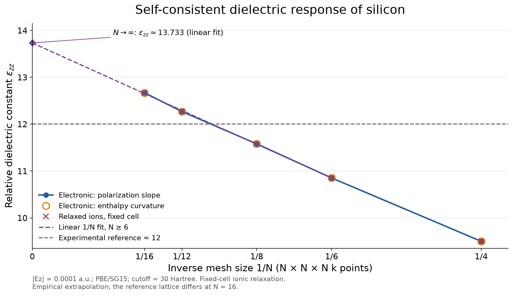

# Silicon finite-field validation

For the completed 16³ calculation with unit-cell and ionic relaxation, see
[the separate cell-relaxation report](VALIDATION_CELL_16.md). It uses a
relaxed zero-field geometry rather than the fixed geometry below.

Validated October 14, 2026 with the modified CPU and CUDA JDFTx executables.
Settings: PBE, SG15 norm-conserving Si pseudopotential, 30-Hartree plane-wave
cutoff, conventional lattice constant 10.26 bohr, two-atom primitive diamond
cell, and four occupied spatial bands. All k points were retained. Electronic
gradient threshold: `1e-9`; internal-ion force threshold: `1e-7`. Lattice
vectors were fixed.

The following values use centered physical Cartesian fields `E_z = ±1e-4`
atomic units. The gap check is a separate fixed-density zero-field calculation
with eight bands, converged at every sampled k point. Empty bands are absent
from every electric-enthalpy minimization.

| k mesh | Electronic εzz | Static εzz, ion relaxation enabled | From enthalpy curvature | Sampled gap (eV) |
|---|---:|---:|---:|---:|
| 4³ | 9.499960 | 9.499960 | 9.499945 | 0.674689 |
| 6³ | 10.852334 | 10.852335 | 10.852294 | 0.688538 |
| 8³ | 11.578794 | 11.578794 | 11.578806 | 0.599689 |
| 12³ | 12.268856 | 12.268856 | 12.268963 | 0.555746 |

The 4³, 6³ and 8³ results used the CPU executable; the complete 12³ response
used CUDA. A separate 12³ CPU calculation at `E_z=-2e-4` agrees with CUDA to
`5.0e-12` electrons/bohr² in polarization and `5.7e-14` Hartree in enthalpy.

Doubling the field to `2e-4` changes εzz by at most `9.7e-4` over these meshes.
The relaxed-ion correction is below `1.2e-6`, consistent with the absence of
a linear lattice dielectric contribution in ideal diamond silicon. At 12³
the polarization slope and enthalpy-curvature values differ by `1.1e-4`.

The fixed-geometry 12³ result is close to the experimental reference near 12 supplied
in the request. **It is not an extrapolated or fully k-mesh-converged value:**
the change from 8³ to 12³ is still 0.69. Finer meshes are needed for a precise
limiting PBE value; the implementation does not fit to the experimental number.



The plot uses inverse mesh size **1/N**, with zero marking the infinite-mesh
limit, and includes the 16³ result with **fixed cell and relaxed ions**:
**12.668863** from Berry polarization. The corresponding occupied-Wannier
estimate is **12.655829**. The 16³ Berry result uses the same markers and connecting curve
as the other meshes; its Wannier comparison remains in the numerical report.
The 16³ fixed reference lattice constant is 10.350505 bohr, compared with
10.26 bohr for the 4³–12³ series. The difference from 12³ includes both mesh and geometry changes;
the extrapolation below is therefore empirical. See the [Wannier comparison](VALIDATION_WANNIER_16.md)
for the numerical records and the alternative cell-relaxed response.
Regenerate the PNG and PDF from the committed data with
`python3 plot_convergence.py` in this directory.

## Infinite-mesh extrapolation

An unweighted least-squares fit of the fixed-cell, relaxed-ion Berry results
at **N = 6, 8, 12 and 16** gives

```
epsilon_zz(N) = 13.7332784 - 17.2897501/N
epsilon_zz(infinity) ≈ 13.73
```

The dashed fit and its intercept at `1/N = 0` are included in the figure.
N = 4 is excluded from the primary fit to emphasize the finer meshes.
Electronic polarization and electronic enthalpy curvature independently give
intercepts 13.733279 and 13.733183. The static fit's residual RMS is 0.01471;
this is a fit diagnostic, not an uncertainty on the physical limiting value.

| Static extrapolation | εzz at infinity | Residual RMS |
| --- | ---: | ---: |
| Linear in 1/N, N ≥ 6 (primary) | 13.7333 | 0.0147 |
| Linear in 1/N, N ≥ 8 | 13.7354 | 0.0170 |
| Linear in 1/N, all five meshes | 13.6891 | 0.0232 |
| Linear in 1/N, same geometry N = 4–12 | 13.6500 | 0.0141 |
| Quadratic in 1/N, N ≥ 6 | 13.7867 | 0.0138 |
| Linear in 1/N², N ≥ 6 | 12.8463 | 0.0904 |

These fits support a provisional **linear-extrapolation estimate near 13.7**,
but do not establish the asymptotic scaling. The pure 1/N² fit describes the
available data less well; its different intercept illustrates model
sensitivity and is not a statistical confidence bound. The 16³ reference
geometry differs from the others, and the field amplitude and plane-wave
cutoff also require convergence for a precise dielectric limit.

The infinite-mesh dielectric limit should be approached with fields tending
to zero: the finite-field enthalpy's critical field decreases as the mesh is
refined, as described by [Souza, Íñiguez and Vanderbilt,
PRL 89, 117602 (2002)](https://journals.aps.org/prl/abstract/10.1103/PhysRevLett.89.117602).
Extrapolating these weak-field finite differences is an estimate of the
linear response, rather than evidence of a stable enthalpy minimum at
fixed nonzero field and arbitrarily large N. No Wannier extrapolation is
available from its single mesh size. Full coefficients, selected meshes and
fit diagnostics are saved in [validation-extrapolation.json](validation-extrapolation.json).

The full Cartesian clamped-ion tensor was also calculated at 8³ and `h=1e-4`:

```
11.57879386   0.03019284   0.03019285
 0.03019280  11.57879366   0.03019286
 0.03019286   0.03019288  11.57879343
```

The tensor is symmetric to `4.0e-8` and has positive eigenvalues. The diagonal
spread is below `5e-7`. Small off-diagonal entries reflect the lattice-direction
Berry discretization; their z-column magnitude decreases from 0.106 at 4³ to
0.0105 at 12³. They must be converged with the mesh.

Seven Berry-specific CTest regressions passed: occupied-orbital and full DFT
directional derivatives, gauge rotations, reciprocal boundary phases, neutral
translation, finite-field ionic forces, collinear/spinor occupation factors,
shifted/common-basis meshes, MPI, GPU, and the complete silicon workflow.
Four existing CPU regressions also passed: k-mesh correlation, batched
projectors, spin kernel, and projector cache. The shifted/common-basis check
also passed with an AddressSanitizer-linked test executable.

These checks exposed and fixed two existing numerical/ownership issues needed
by the new path: the complex determinant omitted LU permutation parity, and
copied basis index arrays shared owning storage, causing a double free.

Numerical outputs are available in [CSV](validation.csv) and
[JSON](validation.json); the plot is also available as [PDF](validation-convergence.pdf).
Complete calculation artifacts remain in `results-tight/k4`, `results-tight/k6`,
`results-tight/k8`, `results-tensor/k8`, and `results-gpu/k12`.
`results-reference-k12` contains the independent CPU reference rather than a
complete dielectric workflow.
